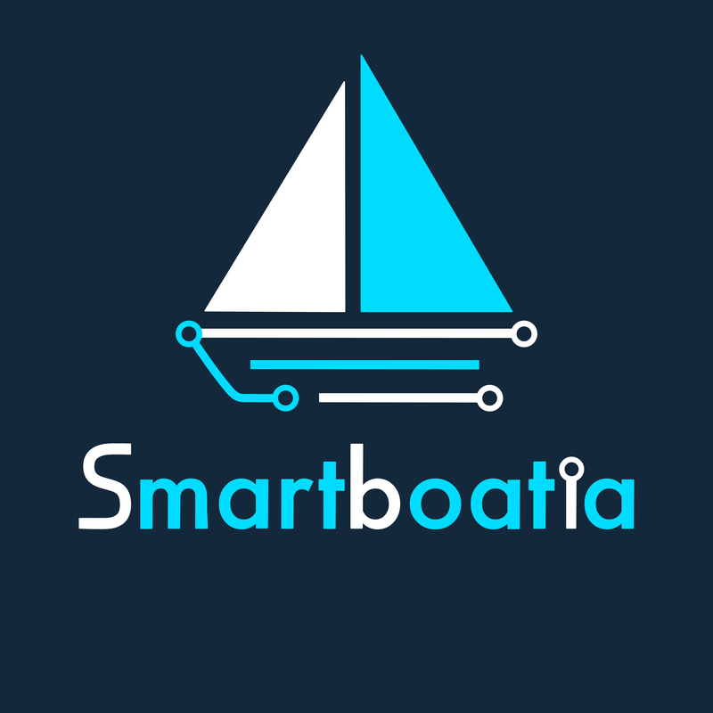

  

<h1 align="center">Your boat knows more than it shows you.</h1>

  Smartboatia makes boats smarter, for sail and motor boats alike. 
  A logbook that writes itself, boat monitoring on board and ashore, and your boat's data: open and yours.

  <a href="https://www.smartboatia.com/en/"><b>smartboatia.com</b></a> ·
  <a href="https://www.smartboatia.com/en/30-day-trial/">Try it for 30 days</a> ·
  <a href="https://smartboatia.atlassian.net/servicedesk/customer/portals">Help portal</a>

---

### What we build

Boats produce a lot of useful data: wind, position, batteries, engine, manoeuvres. Almost none of it gets used. Smartboatia changes that. The Smartboatia Hub on board, the app and the cloud work together and turn that data into answers instead of numbers.

- 📔 **Logbook that writes itself.** Casting off, anchoring, mooring and manoeuvres, logged automatically.
- ⚓ **Boat monitoring.** Anchor watch, batteries and position at a glance, on board and ashore.
- 🌬️ **Weather and environment.** Real trends measured by your own boat, exactly where you are.
- 🧭 **Plotter and navigation.** Instruments and charts on your phone and tablet.
- 📱 **Community and sharing.** Share your trips with crew, family and friends.
- 🏆 **Sailing performance.** Polars from your own data, trim tips and manoeuvre analysis.

### Open by design

Your data belongs to you. We use open interfaces and connect to what you already have instead of locking you in. That is why we publish integrations here on GitHub, starting with **[Smartboatia for Home Assistant](https://github.com/smartboatia/home-assistant-smartboatia)**.

### Who we are

A team of sailors from Travemünde on the Baltic Sea, Germany. Smartboatia is built so that environmental data from boats can support ocean research, if you choose to share it.

<b>Sail smarter. Sail together. Protect the oceans.</b>

